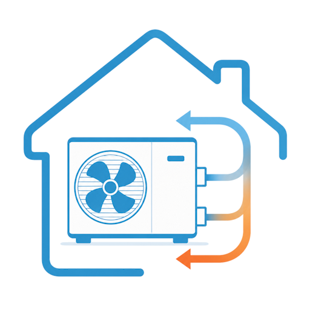

# ioBroker.luxtronik2-controller

**Tests:** 

## luxtronik2-controller adapter for ioBroker

This ioBroker adapter enables the local control, optimization, and monitoring of heat pumps with [Luxtronik 2.x / 3.x controllers](https://www.alpha-innotec.com/en/products/accessories/control/luxtronik) (e.g., Alpha Innotec, Novelan). The adapter is written entirely in TypeScript.

## Acknowledgements & History

This project builds upon the preliminary work of existing open-source projects. Special thanks go to:

- **[Bouni](https://github.com/bouni/luxtronik-2):** Whose pioneering work and code developments form the essential foundation for communication with Luxtronik controllers.
- **[Coolchip](https://github.com/coolchip/luxtronik2):** For the fundamental reverse engineering of the Luxtronik network protocol.
- **[UncleSamSwiss](https://github.com/UncleSamSwiss/ioBroker.luxtronik2):** For the original ioBroker adapter.
- **[BenPru](https://github.com/BenPru/luxtronik) & rhammen:** A special thanks to BenPru and rhammen for their continuous further development regarding the access and control of the Luxtronik controller. Without their dedication, efforts, and ideas, this adapter would not have reached the advanced state it is in today. _(If you appreciate their work, feel free to buy them a coffee! ☕) [BenPru](https://github.com/sponsors/BenPru) [rhammen](https://github.com/sponsors/rhammen)_

**Innovations in this version:**
The `luxtronik2-controller` natively integrates both classic TCP communication (Port `8888` / `8889`) and modern WebSockets (Port `8214` for firmware > V3.81), combined with an optional **Hybrid Modbus TCP** engine (Port `502`) for wear-free RAM writes. Additionally, it features intelligent cycle optimization, dynamic pump control, hardware flash-wear protection, COP/JAZ efficiency tracking, and automated datapoint management.

### Features

- **Native TCP & WebSocket Communication:** Direct connection to the heat pump via classic TCP (`8888` / `8889`) or WebSockets (`8214`) without external protocol overhead.
- **Hybrid Modbus TCP Support (0% Flash Wear):** Write volatile parameters (target temperatures, heating curves, operating modes) and coils/switches directly into the controller's RAM via Modbus TCP (Port `502`) without wearing out the internal EEPROM flash memory, while continuing to read full telemetry via the native port. Active Modbus states are automatically tagged with `(Modbus)` in the object tree.
- **Hardware & EEPROM Flash Protection:**
    - **Read-Before-Write Cache:** Intercepts and blocks redundant write commands if the controller parameter is already at the target value.
    - **Flash Write Counters:** Transparently tracks daily (`write_cycles_today`) and cumulative (`write_cycles_total`) EEPROM write operations.
    - **Idle Defaults & Interactive Heat Curve:** Automatically restores safe baseline settings when the heat pump enters standby, featuring a live interactive SVG heat curve preview in the Admin UI.
    - **Firmware `.90` Crash Shield:** Automatically detects buggy manufacturer firmwares (`V1.90` / `V2.90`) and blocks network writes to prevent hardware crashes.
- **COP & JAZ (Efficiency Calculator):** Calculate and track heat pump efficiency directly within the adapter (_Today_, _Last 7 Days_, _Current Month_, _Current Year_), automatically split into _Heating_, _Hot Water_, and _Total_. Supports internal Luxtronik counters or high-precision external meters (e.g., Shelly 3EM, M-Bus heat meters) with persistent database storage (`hidden.cop_buckets`) and anti-flapping zero-drop protection.
- **Compressor Protection (Cycle Optimization):** Intelligently links heating and domestic hot water (DHW) cycles to prevent unnecessary compressor stops and starts.
- **Dynamic HUP Control (with Auto-PWM Detection):** Automatically scales the 0–10V control voltage of the heating circulation pump (HUP) based on the supply/return temperature spread. PWM-controlled pumps are automatically detected and bypassed.
- **Smart 3-Way Circulation Pump (ZIP) Control:**
    - Choose intuitively between **Internal Luxtronik Controller**, **External Actor** (e.g., Shelly with 0% flash wear), or **Modbus TCP (Coil 7)**.
    - Trigger circulation on-demand via ioBroker motion sensors/buttons (with anti-cycling cooldown) or synchronously during hot water generation.
    - Includes live virtual status (`Virtual_ZIP_Status`) and a real-time remaining runtime countdown in seconds (`Virtual_ZIP_Remaining_Time`).
- **Integrated Actions (Macros):** Pre-defined triggers for forced heating (`Zwangsheizen`), forced hot water (`Zwangswarmwasser`), circulation (`Activate_Zip`), manual default resets (`Setze_Vorgabewerte`), and full raw data dumps (`Dump_Raw_To_Log`).
- **Smart Object Management & Visibility Filter:** Queries hardware visibility flags (Command `3005`) on startup to automatically hide unsupported system components (e.g., cooling, solar, ventilation, or uninstalled mixing circuits). Deselected categories, datapoints, and empty folders are cleanly removed on restart.
- **Custom Datapoints:** Flexibly add custom telemetry values (Index `3004`) and writable parameters (Index `3003`) via the Admin UI, including custom scaling factors, units, and automatic Unix timestamp formatting.
- **Extended Status Texts & Calculations:** Live calculation of temperature spread, thermal/electrical energy sums, and translated clear-text system states (including heating offsets, frost protection, and cooling status in German or English).
- **Intelligent Notification System:** Dispatches error logs, connectivity alerts, and critical shutdowns (such as water flow rate issues) to **Telegram** and the **ioBroker Notification Center** – including a 60-minute anti-spam cooldown and a live test button.
- **Automated DTA Backup:** Manual one-click links and scheduled Cron downloads of internal `.dta` diagnostic logs directly from the heat pump to `0_userdata.0/luxtronik_backups` for analysis in tools like _OpenDTA_.
- **Broad Compatibility:** Full support for older (V1.x / V2.x) and newer (V3.x) firmware generations using dynamic scaling factors and adaptive write-queue timing.

## ⚠️ Warning

Some settings provided by this integration can affect the performance of your heat pump. Misconfigurations can cause the controller to enter a fault state, which requires a manual on-site reset.

This project aims to protect your heat pump by restricting the configuration options to safe values. However, no guarantees can be made. Please be careful, consult your Luxtronik manual, and do not change any settings that you do not fully understand.

## 🔧 Compatibility

The integration allows you to monitor and control heat pumps with a Luxtronik2 controller. It works locally without internet access.
It was and is being tested with an LWD50A (LD5) from Alpha Innotec.
It is used by manufacturers such as:

- Alpha Innotec,
- Siemens,
- Novelan,
- Roth,
- Elco,
- Buderus,
- Nibe,
- Wolf Heiztechnik.

## ⚠️ Disclaimer ⚠️

_This project is not affiliated with Alpha Innotec, Novelan, ait-deutschland GmbH, or any other company. It is a personal project that is maintained in spare time. Use at your own risk._

## Reporting Bugs & Contributing

Bug reports, compatibility notes for specific firmware versions, or feature requests can be submitted via the issue tracker in the [GitHub-Repository](https://github.com/TbsJah/ioBroker.luxtronik2-controller/issues).

## Installation

**Note for Raspberry Pi / ARM users:**
You might see red error messages in the installation log related to `node-gyp`, `serialport`, or `usocket`. These are optional dependencies and can be completely ignored. The network-based control (TCP) of the Luxtronik will still work without any issues.

## Information

[Info Deutsch](documentation/readme_de.md)

[Info English](documentation/readme_en.md)

## Changelog

// ### **WORK IN PROGRESS**

### **WORK IN PROGRESS**

**📝 Documentation & Guide Overhaul**

- **Complete Alignment of Documentation (`README.md` & `documentation/readme_de.md` & `documentation/readme_en.md`):**
    - Restructured and synchronized both German and English documentation to accurately match all **11 configuration tabs** of the Admin UI in sequential order:
    - **Hardware Protection Architecture:** Added an explicit section explaining Read-Before-Write protection (`writePumpSafe`), daily and total flash cycle counters, and the vendor firmware `.90` crash shield.
    - **Troubleshooting & ARM Compatibility:** Added troubleshooting documentation regarding harmless `node-gyp` / `serialport` / `usocket` compilation warnings on Raspberry Pi / ARM systems, alongside step-by-step guidance for running the raw TCP diagnostic script (`Test_Script.ts`).

### 0.19.0 (2026-10-19)

**🚀 Features & UX Improvements**

- **Hybrid Modbus TCP Support:** Introduced hybrid Modbus TCP support (`modbus-serial`) to write volatile parameters (e.g., target temperatures, heating curves, and coils/switches) directly into the Luxtronik RAM without causing EEPROM/flash memory wear, while continuing to read full telemetry via native port 8889/8214.
- **Smart ZIP Configuration:** Completely redesigned the Circulation Pump (ZIP) tab in the Admin UI. Introduced a dynamic dropdown (`zip_control_mode`) to intuitively switch between Internal Controller, External Actor (e.g., Shelly), and Modbus TCP (Coil 7), automatically hiding irrelevant settings to prevent misconfigurations.
- **ZIP Countdown Timer:** Added a new virtual datapoint (`Information.03_Outputs.Virtual_ZIP_Remaining_Time`) that displays the remaining runtime of the active circulation pump cycle in seconds.
- **Seamless Migration:** Implemented an automatic background migration routine to seamlessly upgrade existing user configurations to the new ZIP control logic without data loss.

**🐛 Bugfixes**

- **Telegram Notifications UI:** Fixed a logic issue in `jsonConfig.json` where the Telegram warning message was incorrectly displayed even when instances were installed and available, and fixed the broken icon on the test button.

**📝 Documentation**

- **ARM Installation Notes:** Added a troubleshooting note to the README clarifying that `usocket`, `serialport`, and `node-gyp` compilation errors on Raspberry Pi / ARM systems originate from optional serial dependencies and can be safely ignored.

### 0.18.2 (2026-10-17)

**🔧 Maintenance & Repository Compliance**

- **Core Dependency Update:** Raised minimum required `js-controller` dependency to `>=7.0.7` in `io-package.json` to ensure compatibility with modern ioBroker environments (resolves E1057).
- **Full i18n Localization for Admin UI:** Added complete multi-language label sets (`ru`, `pt`, `nl`, `fr`, `it`, `es`, `pl`, `uk`, `zh-cn`) for COP power and thermal source selection dropdowns in `jsonConfig.json` (resolves W5611).
- **Package News Cleanup:** Removed unreleased intermediate tags (`0.17.0`, `0.16.1`) from `common.news` in `io-package.json` to align strictly with published NPM releases (resolves W2004).
- **CI/CD Security Compliance:** Updated GitHub auto-merge workflows for Dependabot to adhere to GitHub's updated `pull_request_target` execution policies (PR #90 / Issue #89).
- **Code Modernization:** Migrated built-in Node.js module imports to use the explicit `node:` protocol prefix (e.g. `node:fs`, `node:path`).

### 0.18.1 (2026-10-13)

**🐛 Bugfixes**

- **COP Database Persistence:** Fixed a critical bug in the object manager's cleanup routine (`cleanupStates`). The internal database folder (`hidden.cop_buckets`) was missing from the exclusion list and got aggressively deleted upon every adapter restart, resulting in wiped COP histories and `(null)` values. The hidden states are now strictly protected against the cleanup process, ensuring long-term persistence for energy calculations.

### 0.18.0 (2026-10-12)

**🚀 Features & Enhancements**

- **Smart PWM Pump Detection:** The `hupManager` now automatically detects whether the heating circulation pump (HUP) is controlled via a PWM signal (verified by checking if `heating_max_circ_pump_speed > 0%`). If this is the case, the obsolete dynamic 0-10V voltage optimization is automatically bypassed. This saves system resources and prevents unnecessary write commands to the Luxtronik controller.

**🐛 Bugfixes**

- **HUP Voltage Validation Fixed:** Fixed an issue where ioBroker threw a warning ("nur zwischen 3 und 10 V erlaubt") in the log for HUP voltage values below 3V. The object definitions for minimum and nominal voltage have been explicitly updated to `min: 0` and `max: 10`. This successfully overwrites lingering cache limits in the ioBroker database and allows the pump to transition into 0V standby mode without throwing errors.

### 0.17.3 (2026-10-12)

**🚀 Features & Enhancements**

- **Persistent COP Counters:** Raw energy counters (`last_raw_power`, `last_raw_thermal`) are now safely stored in the ioBroker database (`hidden.cop_buckets`) instead of volatile RAM. Consumption data is no longer lost during adapter instance or ioBroker host restarts, ensuring seamless and continuous delta calculation.

**🐛 Bugfixes**

- **Anti-Flapping Protection for Energy Counters (Root-Cause Fix):** Fixed a timing bug that caused the internal sum counters for thermal and electrical energy (`thermalenergy_total`, `energy_total`) to temporarily drop to `0 kWh`. The calculation function (`calculateSum`) now blocks physically impossible negative jumps and only writes new sums if they are greater than or equal to the previous peak value.
- **COP Operating State Recognition:** The COP script no longer ignores energy increments for heating and hot water. The evaluation of the operating state (`WP_BZ_akt`) has been improved to reliably parse text strings with parentheses (e.g., `"Warmwasser(1)"` or `"Heizbetrieb(0)"`), correctly sorting the calculated deltas into their respective buckets (`Heating` / `HotWater`).
- **CI/CD & Code Quality:** Resolved strict ESLint rule violations (`curly`) in the `copManager` by adding block braces to single-line `if` conditions, allowing the GitHub Actions build pipeline to pass successfully.
- **Core Anti-Flapping Protection for Energy Counters:** Fixed a critical timing and raw data glitch where the heat pump occasionally transmits `0 kWh` for cumulative energy counters. A strict validation gate was implemented directly into the core polling loop (`main.ts`). All incoming updates for energy, thermal, and power states are now intercepted and discarded if they are lower than the currently persisted ioBroker state. This prevents faulty zero-drops from ever reaching the database and ensures clean, continuously rising graphs in history adapters like InfluxDB.

## License

MIT License

Copyright (c) 2026 TbsJah <github.tbsjah@googlemail.com>

Permission is hereby granted, free of charge, to any person obtaining a copy
of this software and associated documentation files (the "Software"), to deal
in the Software without restriction, including without limitation the rights
to use, copy, modify, merge, publish, distribute, sublicense, and/or sell
copies of the Software, and to permit persons to whom the Software is
furnished to do so, subject to the following conditions:

The above copyright notice and this permission notice shall be included in all
copies or substantial portions of the Software.

THE SOFTWARE IS PROVIDED "AS IS", WITHOUT WARRANTY OF ANY KIND, EXPRESS OR
IMPLIED, INCLUDING BUT NOT LIMITED TO THE WARRANTIES OF MERCHANTABILITY,
FITNESS FOR A PARTICULAR PURPOSE AND NONINFRINGEMENT. IN NO EVENT SHALL THE
AUTHORS OR COPYRIGHT HOLDERS BE LIABLE FOR ANY CLAIM, DAMAGES OR OTHER
LIABILITY, WHETHER IN AN ACTION OF CONTRACT, TORT OR OTHERWISE, ARISING FROM,
OUT OF OR IN CONNECTION WITH THE SOFTWARE OR THE USE OR OTHER DEALINGS IN THE
SOFTWARE.

[Older changelogs can be found there](CHANGELOG_OLD.md)
