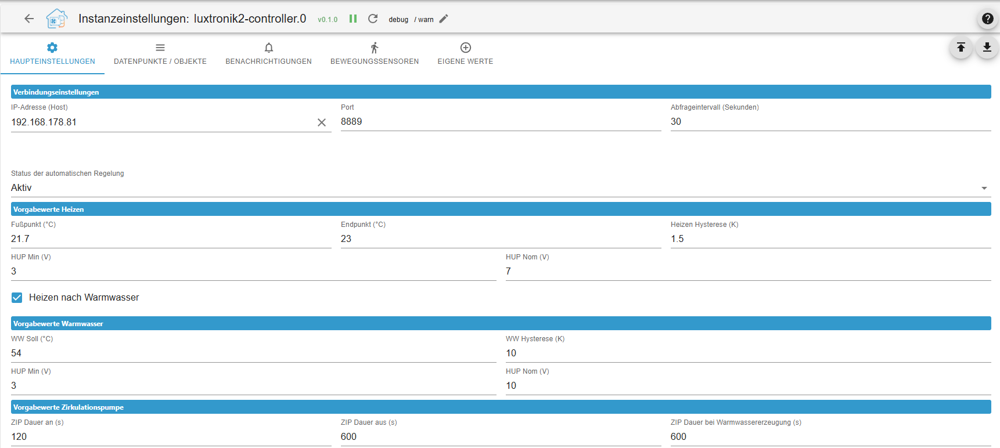
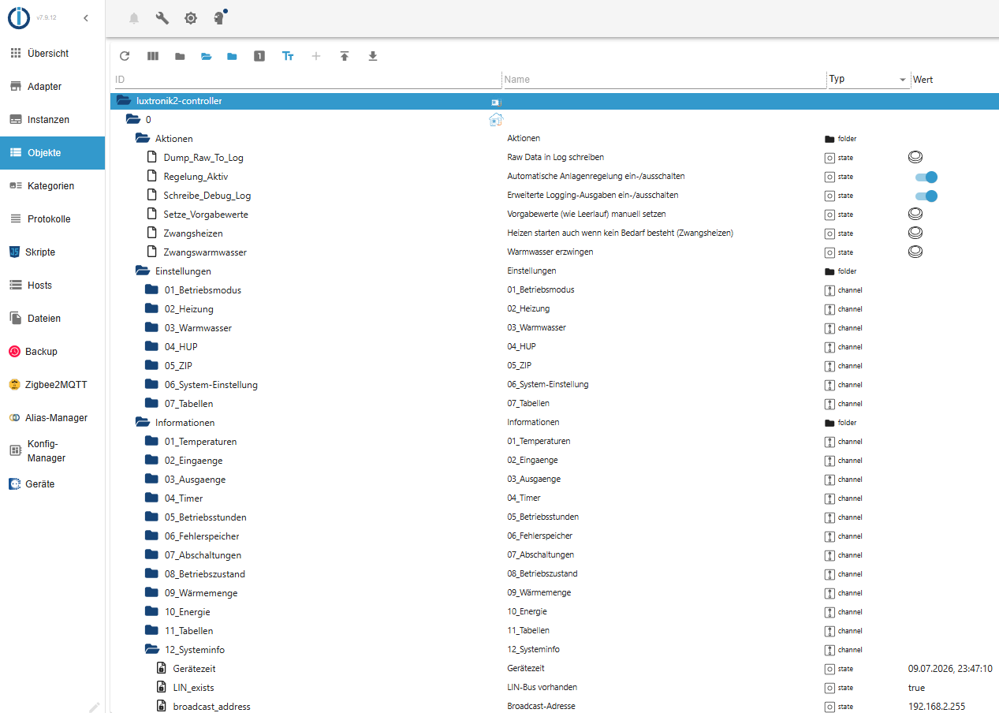
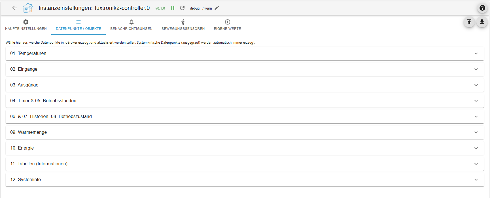
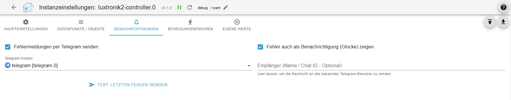
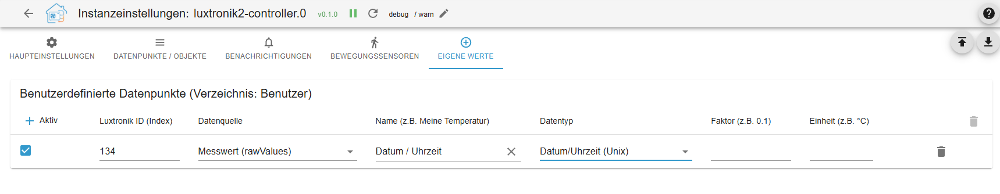
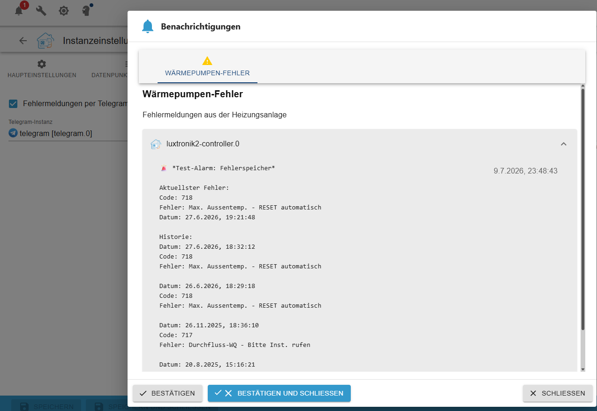
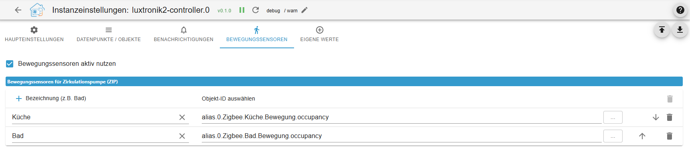

# ioBroker.luxtronik2-controller

**Tests:** 

## luxtronik2-controller adapter for ioBroker

This ioBroker adapter enables the local control and monitoring of heat pumps with [Luxtronik 2.x controllers](https://www.alpha-innotec.com/en/products/accessories/control/luxtronik) (e.g., Alpha Innotec, Novelan). The adapter is written entirely in TypeScript.

## Acknowledgements & History

This project builds upon the preliminary work of existing open-source projects. Special thanks go to:

[Bouni](https://github.com/bouni/luxtronik-2) Whose pioneering work and code developments form the essential foundation for communication with Luxtronik controllers.

[Coolchip:](https://github.com/coolchip/luxtronik2) For the fundamental reverse engineering of the Luxtronik network protocol.

[UncleSamSwiss:](https://github.com/UncleSamSwiss/ioBroker.luxtronik2) For the original ioBroker adapter.

Innovations in this version: The luxtronik2-controller natively integrates TCP communication (Port 8888 / 8889) and does not rely on external libraries. Additionally, controlling macros, a logic for compressor protection, and automated datapoint management were implemented.

### Features

- **Native TCP Communication:** Direct connection to the heat pump without any additional overhead.
- **COP & JAZ (Efficiency Calculator):** The heat pump's efficiency can now be calculated and tracked directly within the adapter (Today, 7 Days, Month, Year). Live metrics are automatically split into Heating, Hot Water, and Total. You can either use the internal Luxtronik estimates or link high-precision external meters (e.g., Shelly 3EM) via Object IDs.
- **Compressor Protection (Cycle Optimization):** Intelligent merging of heating and domestic hot water (DHW) cycles to significantly reduce compressor starts.
- **Dynamic HUP Control:** Automatic voltage adjustment of the heating circulation pump (HUP) based on the flow and return temperature spread for maximum efficiency.
- **Integrated Actions (Macros):** Pre-defined control logic for forced heating, DHW requests, and the circulation pump (ZIP) – including an automatic fallback to safe default values.
- **Demand-Driven Circulation (ZIP):** Control your circulation pump via existing ioBroker motion sensors or directly via external actuators (e.g., Shelly) – entirely without hardware modifications to the heat pump.
- **Custom Datapoints:** Measured values (Index 3004) and parameters (Index 3003) can be flexibly added via the adapter configuration. Unix timestamps are automatically parsed into human-readable formats.
- **Extended Status Texts & Calculations:** Live calculation of temperature spread, thermal energy, and detailed text outputs of current system states (including offsets, frost protection, and cooling status).
- **Intelligent Notification System:** Send error codes and critical shutdowns (like flow rate issues) directly to Telegram or the ioBroker notification system – complete with cooldown spam protection.
- **Automated DTA Backup:** Scheduled downloads of DTA diagnostic logs directly from the heat pump to your ioBroker storage for easy analysis (e.g., in OpenDTA).
- **Automatic Object Management:** Deselected or deleted datapoints, as well as empty folder structures, are automatically and cleanly removed from ioBroker upon an adapter restart.
- **Broad Compatibility:** Full support for older (V2.x) and newer (V3.x) firmware generations (e.g., Alpha Innotec, Novelan) utilizing dynamic scaling factors.

## ⚠️ Warning

Some settings provided by this integration can affect the performance of your heat pump. Misconfigurations can cause the controller to enter a fault state, which requires a manual on-site reset.

This project aims to protect your heat pump by restricting the configuration options to safe values. However, no guarantees can be made. Please be careful, consult your Luxtronik manual, and do not change any settings that you do not fully understand.

## 🔧 Compatibility

The integration allows you to monitor and control heat pumps with a Luxtronik2 controller. It works locally without internet access.
It was and is being tested with an LWD50A (LD5) from Alpha Innotec.
It is used by manufacturers such as:

- Alpha Innotec,
- Siemens,
- Novelan,
- Roth,
- Elco,
- Buderus,
- Nibe,
- Wolf Heiztechnik.

## ⚠️ Disclaimer ⚠️

_This project is not affiliated with Alpha Innotec, Novelan, ait-deutschland GmbH, or any other company. It is a personal project that is maintained in spare time. Use at your own risk._

## Reporting Bugs & Contributing

Bug reports, compatibility notes for specific firmware versions, or feature requests can be submitted via the issue tracker in the [GitHub-Repository](https://github.com/TbsJah/ioBroker.luxtronik2-controller/issues).

## Information

[Info Deutsch](documentation/readme_de.md)

[Info English](documentation/readme_en.md)

## Changelog

// ### **WORK IN PROGRESS**
**WORK IN PROGRESS**

### **Changelog (Work in Progress)**

**🚀 Features & Enhancements**

- **Persistent COP Counters:** Raw energy counters (`last_raw_power`, `last_raw_thermal`) are now safely stored in the ioBroker database (`hidden.cop_buckets`) instead of volatile RAM. Consumption data is no longer lost during adapter instance or ioBroker host restarts, ensuring seamless and continuous delta calculation.

**🐛 Bugfixes**

- **Anti-Flapping Protection for Energy Counters (Root-Cause Fix):** Fixed a timing bug that caused the internal sum counters for thermal and electrical energy (`thermalenergy_total`, `energy_total`) to temporarily drop to `0 kWh`. The calculation function (`calculateSum`) now blocks physically impossible negative jumps and only writes new sums if they are greater than or equal to the previous peak value.
- **COP Operating State Recognition:** The COP script no longer ignores energy increments for heating and hot water. The evaluation of the operating state (`WP_BZ_akt`) has been improved to reliably parse text strings with parentheses (e.g., `"Warmwasser(1)"` or `"Heizbetrieb(0)"`), correctly sorting the calculated deltas into their respective buckets (`Heating` / `HotWater`).
- **CI/CD & Code Quality:** Resolved strict ESLint rule violations (`curly`) in the `copManager` by adding block braces to single-line `if` conditions, allowing the GitHub Actions build pipeline to pass successfully.
- **Core Anti-Flapping Protection for Energy Counters:** Fixed a critical timing and raw data glitch where the heat pump occasionally transmits `0 kWh` for cumulative energy counters. A strict validation gate was implemented directly into the core polling loop (`main.ts`). All incoming updates for energy, thermal, and power states are now intercepted and discarded if they are lower than the currently persisted ioBroker state. This prevents faulty zero-drops from ever reaching the database and ensures clean, continuously rising graphs in history adapters like InfluxDB.

### 0.17.2 (2026-10-11)

#### 🛠 Bugfixes & Enhancements

- **Log copManager:** Fixed an issue regarding the log output in the COP calculation engine.

### 0.17.1 (2026-10-11)

#### 🛠 Bugfixes & Enhancements

- **Code Quality & CI/CD:** Fixed ESLint `no-prototype-builtins` pipeline failures in `objectManager.ts` by replacing direct `.hasOwnProperty()` calls with safe `Object.prototype.hasOwnProperty.call()` methods.

### 0.17.0 (2026-10-11)

#### 🚀 Features

- **COP & Efficiency Calculator:** Introduced a comprehensive COP (Coefficient of Performance) calculation engine to track heat pump efficiency.
- **External Smart Meter Support:** Users can now choose to use internal Luxtronik estimates or link high-precision external sensors (e.g., Shelly 3EM or M-Bus heat meters) via ioBroker Object IDs for power consumption and thermal energy generation.
- **Granular Live Metrics:** The adapter now dynamically analyzes the active operating state to split and calculate live daily COP values for "Total", "Heating", and "Hot Water" independently.
- **Persistent Time Rollovers:** Implemented a robust "snapshot" system with absolute virtual counters. The adapter automatically detects day, month, and year rollovers to persist data and guarantee accurate long-term calculations, even across adapter restarts or ioBroker reboots.
- **Dedicated Efficiency UI:** Added a new "Efficiency / COP" configuration tab to easily manage energy data sources and toggle the calculation engine.
- **Connection & Polling Status:** Added a new system datapoint `info.lastUpdate`. This state continuously tracks the exact timestamp of the last successful data retrieval, making it easy to monitor the adapter's health and polling activity in visualisations like VIS or Lovelace.

#### 🛠 Bugfixes & Enhancements

- **Object Tree Creation:** Fixed an issue where hidden data buckets for the COP calculation were not created because parent directories were missing.
- **Timestamp Formatting:** Resolved a strict type mismatch error in the ioBroker log by correctly formatting `info.lastUpdate` as an ISO string instead of a numeric timestamp.
- **State Properties & Code Quality:** Resolved strict TypeScript and ESLint warnings (missing JSDoc annotations, missing read/write object definitions) in the new COP manager.
- **Modernized ioBroker API:** Replaced deprecated `setStateAsync` method calls with the modern, promise-based `setState` standard across the COP calculation engine.
- **Config UI Sorting:** Ensured the newly generated configuration tabs maintain a logical and consistent order across rebuilds.
- **Internal Mapping:** Restructured the `info` folder mapping to cleanly accommodate adapter-level metadata alongside hardware telemetry.

### 0.16.1 (2026-10-11)

#### 🚀 Features

- **Enhanced UI Layout:** Improved the "Datapoints" settings tab layout to display up to 4 items side-by-side on larger screens for a better overview and improved usability.

#### 🛠 Bugfixes & Enhancements

- **State Cleanup Logic Fixed:** Resolved an issue where unchecked datapoints (e.g., Room Thermostats) were not removed from the ioBroker object tree. The `isStateEnabled` logic now correctly handles `undefined` config states for dynamically generated checkboxes.

### 0.16.0 (2026-10-11)

#### 🚀 Features

- **Dynamic Admin UI Generation:** The "Datapoints / Objects" configuration tab in the adapter settings is now fully auto-generated during the build process (`prebuild`). This ensures the UI is always 100% in sync with the underlying TypeScript state mappings.
- **Category Master Switches:** Added master toggle switches to the adapter settings. Users can now enable or disable entire hardware categories (e.g., Solar, Cooling, Ventilation) with a single click. This keeps the ioBroker object tree clean and significantly reduces unnecessary polling for unused features.
- **Dynamic Protection for Critical States:** System-critical datapoints are now protected dynamically via a `required: true` flag in the codebase. They are permanently locked (grayed out) in the UI and cannot be accidentally deleted or disabled by the user or the visibility filter.

#### 🛠 Bugfixes & Enhancements

- **Cycle Optimization Logic (Hot Water):** Fixed a logic flaw where the adapter erroneously applied an artificial hot water target temperature increase while the heat pump was already actively running a hot water cycle. The trigger is now strictly limited to the end of regular heating cycles.
- **Build Process Optimized:** Integrated the UI generation script (`generateConfig.ts`) seamlessly into the NPM `prebuild` lifecycle, automatically patching the `jsonConfig.json` before typescript compilation.

## License

MIT License

Copyright (c) 2026 TbsJah <github.tbsjah@googlemail.com>

Permission is hereby granted, free of charge, to any person obtaining a copy
of this software and associated documentation files (the "Software"), to deal
in the Software without restriction, including without limitation the rights
to use, copy, modify, merge, publish, distribute, sublicense, and/or sell
copies of the Software, and to permit persons to whom the Software is
furnished to do so, subject to the following conditions:

The above copyright notice and this permission notice shall be included in all
copies or substantial portions of the Software.

THE SOFTWARE IS PROVIDED "AS IS", WITHOUT WARRANTY OF ANY KIND, EXPRESS OR
IMPLIED, INCLUDING BUT NOT LIMITED TO THE WARRANTIES OF MERCHANTABILITY,
FITNESS FOR A PARTICULAR PURPOSE AND NONINFRINGEMENT. IN NO EVENT SHALL THE
AUTHORS OR COPYRIGHT HOLDERS BE LIABLE FOR ANY CLAIM, DAMAGES OR OTHER
LIABILITY, WHETHER IN AN ACTION OF CONTRACT, TORT OR OTHERWISE, ARISING FROM,
OUT OF OR IN CONNECTION WITH THE SOFTWARE OR THE USE OR OTHER DEALINGS IN THE
SOFTWARE.

[Older changelogs can be found there](CHANGELOG_OLD.md)
